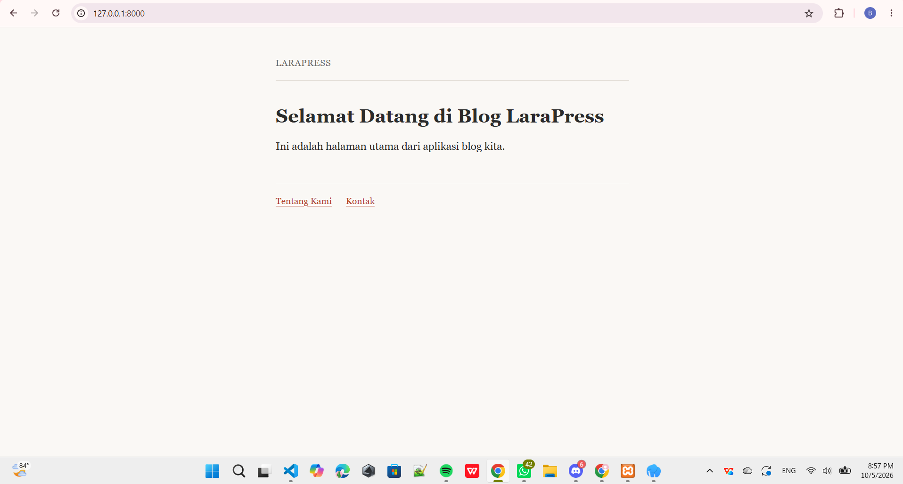
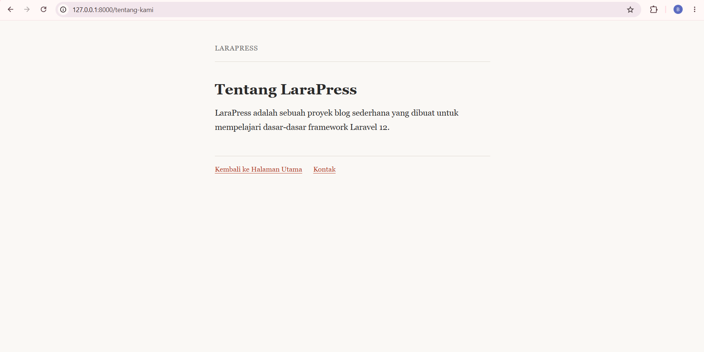
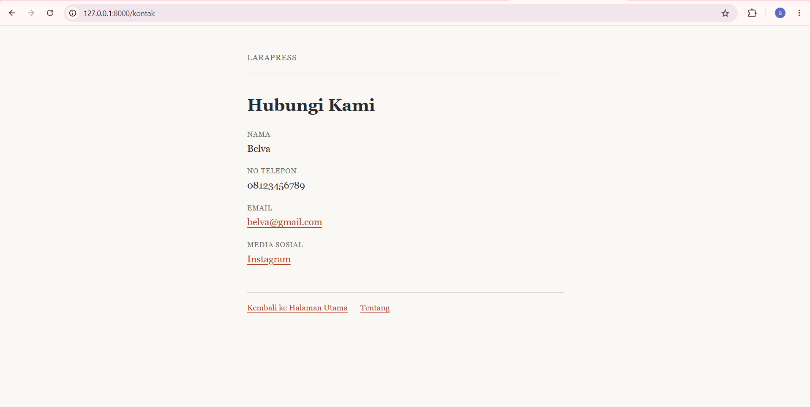

# Laporan Tugas Pertemuan 2
Disusun Oleh:
 
<table>
    <tbody>
        <tr>
            <td>
                Nama:
            </td>
            <td>
                Belvaria Hendriyani
            </td>
        </tr>
        <tr>
           <td>
                NPM:
            </td>
            <td>
                4524210078
            </td>
        </tr>
        <tr>
            <td>
                Kelas:
            </td>
            <td>
                Prak Pemrograman Berbasis Web (A)
            </td>
        </tr>
    </tbody>
</table>

## Pembuatan View
### Home Page
Halaman ini memuat informasi halaman awal atau beranda bagi pengguna yang mengakses url `/`. Isinya berupa judul "Selamat Datang di Blog LaraPress", deskripsi singkat bahwa ini adalah halaman utama aplikasi blog, serta tautan menuju halaman Tentang Kami dan Kontak.

### Tentang Kami
Halaman ini memuat informasi mengenai apa itu proyek LaraPress, yaitu sebuah proyek blog sederhana yang dibuat untuk mempelajari dasar-dasar framework Laravel 12. Halaman ini dapat diakses melalui url `/tentang-kami` dan memiliki tautan untuk kembali ke halaman utama serta menuju halaman Kontak.

### Kontak
Halaman ini memuat identitas pembuat beserta kontak yang dapat dihubungi, meliputi nama, nomor telepon, email, dan media sosial (Instagram). Halaman ini dapat diakses melalui url `/kontak` dan memiliki tautan untuk kembali ke halaman utama serta menuju halaman Tentang.

