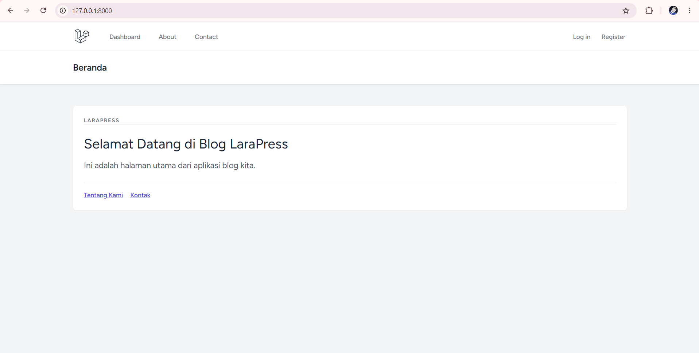
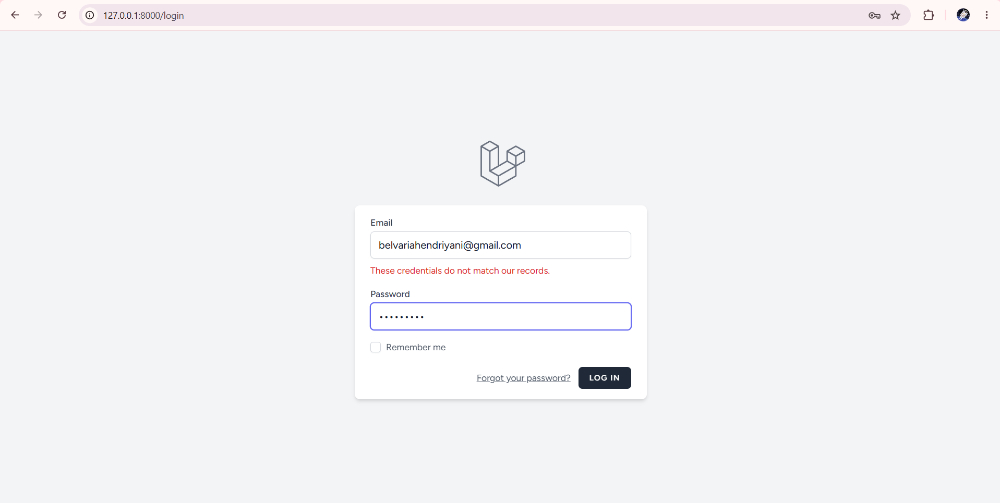
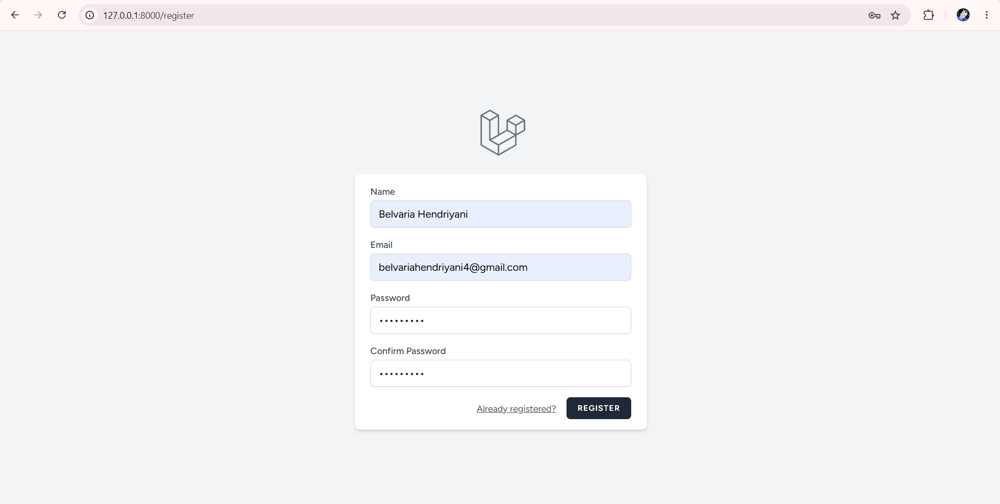
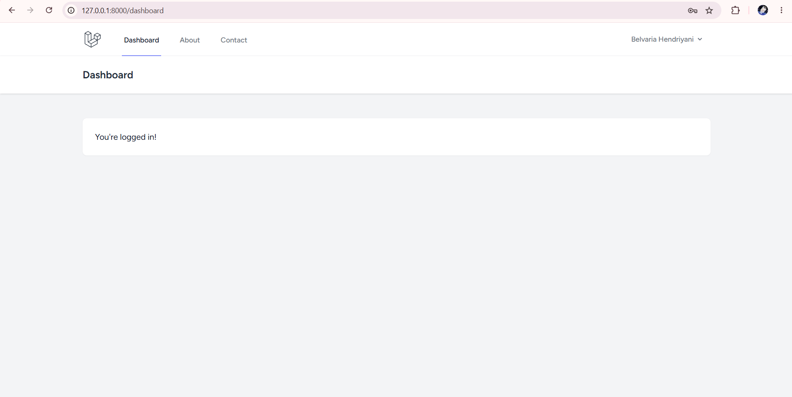
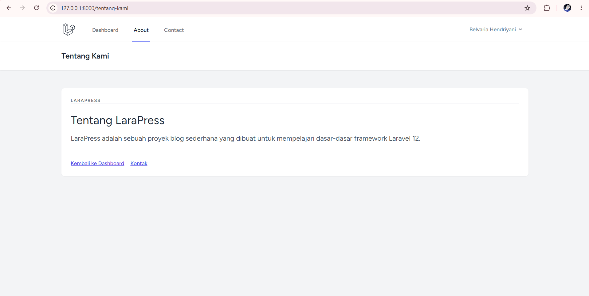
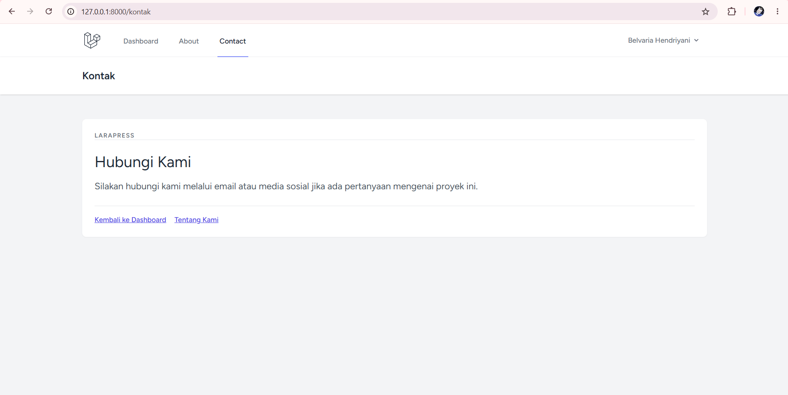

# Laporan Tugas Pertemuan 3

Disusun Oleh:

|            |                                   |
| :--------- | :-------------------------------- |
| **Nama:**  | Belvaria Hendriyani               |
| **NPM:**   | 4524210078                        |
| **Kelas:** | Prak Pemrograman Berbasis Web (A) |

---

## 1. Tampilan Halaman Utama (_Welcome Page / Beranda_)

Halaman utama setelah konfigurasi Laravel Breeze dan layout terpadu.

> 

---

## 2. Halaman Autentikasi (Log in & Register)

Tampilan form masuk dan pendaftaran yang selinear dengan navigasi aplikasi.

> 
> 

---

## 3. Halaman Dashboard Pengguna (_Logged In_)

Tampilan menu navigasi utama serta status akun aktif di pojok kanan atas.

> 

---

## 4. Halaman About & Contact

Integrasi halaman kustom (Tentang Kami dan Kontak) yang tetap mempertahankan navbar utama.

> 
> 
