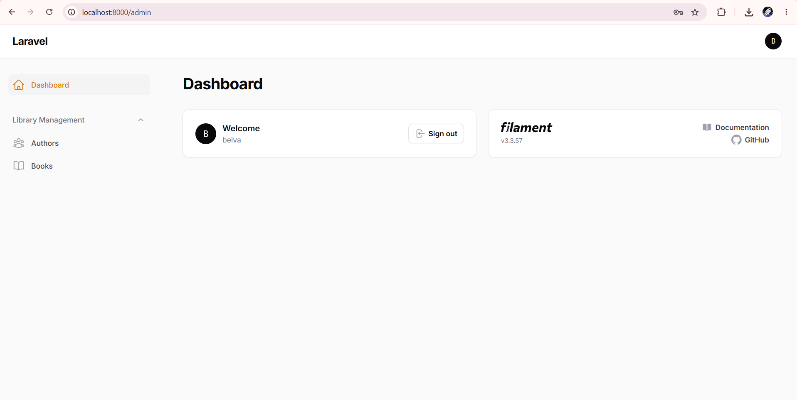
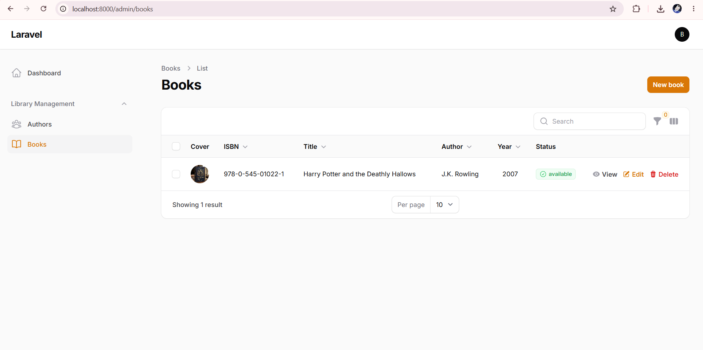
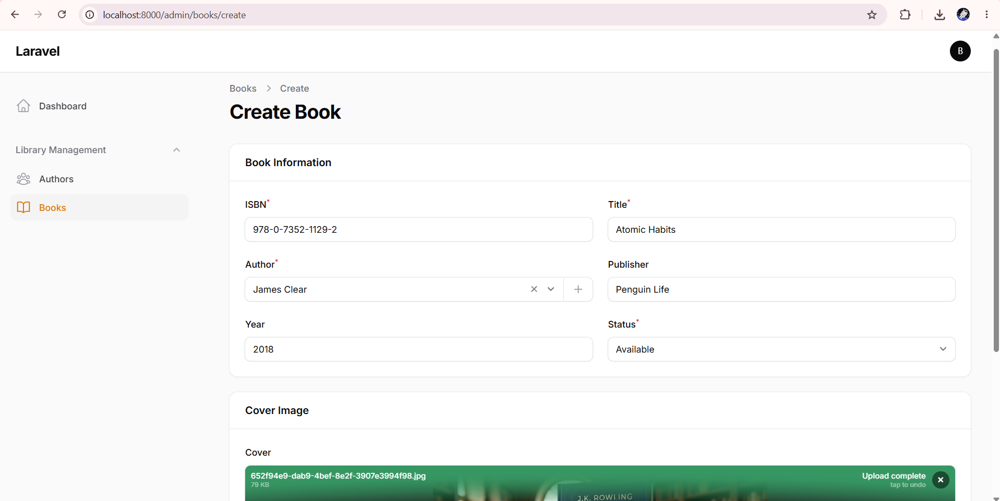
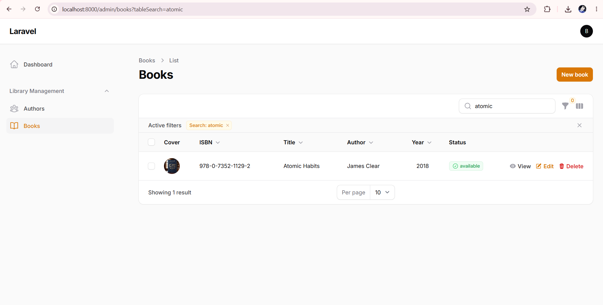
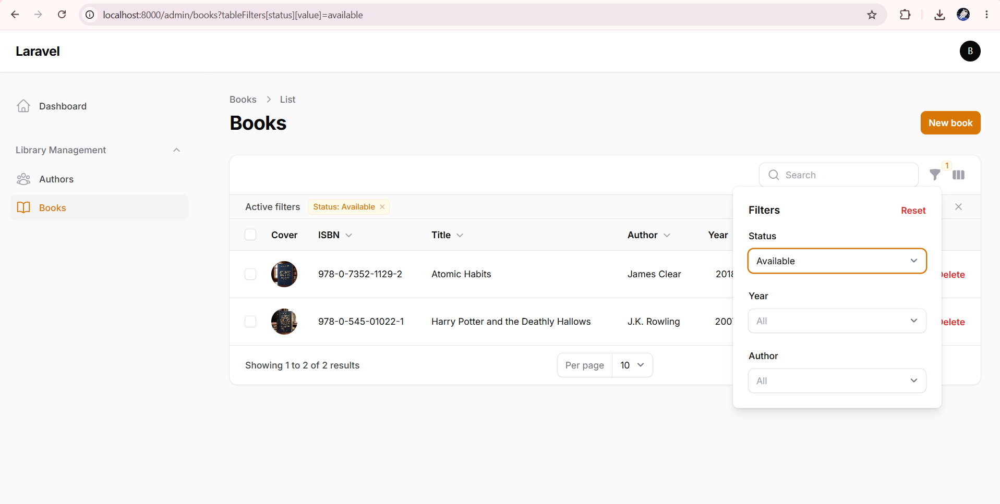

# 📚 Sistem Manajemen Buku - Authbook

Aplikasi Sistem Manajemen Buku berbasis web yang dibangun menggunakan **Laravel 11** dan **Filament 3.x**. Aplikasi ini mencakup pengelolaan data buku dan penulis secara komprehensif, mulai dari fitur CRUD, pencarian, filter, relasi database, hingga manajemen media upload cover buku.

## 🛠️ Fitur Utama

- **Authentication & Dashboard**: Sistem login terproteksi untuk admin panel.

- **Manajemen Authors (Penulis)**: Fitur CRUD untuk mengelola data penulis buku.

- **Manajemen Books (Buku)**:
    - CRUD Data Buku (ISBN, Judul, Penulis, Penerbit, Tahun, Status, Cover).

    - Integrasi relasi _One-to-Many_ dengan tabel `authors`.

    - Fitur _Inline Option Form_ untuk menambahkan penulis baru langsung dari form buku.

    - Upload & Manajemen gambar _cover_ buku.

- **Filtering & Searching**: Pencarian berdasarkan judul/ISBN serta filter status keterSEDIAAN dan tahun terbit.

- **Seeder & Dummy Data**: Populasikan database dengan data dummy realistis menggunakan Faker & Factory.

## 💻 Prasyarat Sistem

Sebelum menjalankan proyek ini, pastikan sistem kamu sudah terinstal:

- **PHP** `>= 8.2`

- **Composer**

- **MySQL / MariaDB** (melalui Laragon / XAMPP)

- **Git**

## 🚀 Panduan Instalasi & Setup Proyek

Ikuti langkah-langkah di bawah ini untuk menjalankan proyek di lingkungan lokal:

### 1. Clone Repositori

```
git clone https://github.com/username/authbook.git
cd authbook

```

### 2. Instal Dependency PHP

Jalankan perintah berikut untuk menginstal seluruh dependensi Laravel dan Filament:

```
composer install

```

### 3. Konfigurasi Environment (`.env`)

Salin file `.env.example` menjadi `.env`:

```
copy .env.example .env

```

Buka file `.env` dan sesuaikan pengaturan database MySQL:

```
APP_NAME=Authbook
APP_URL=http://127.0.0.1:8000

DB_CONNECTION=mysql
DB_HOST=127.0.0.1
DB_PORT=3306
DB_DATABASE=authbook
DB_USERNAME=root
DB_PASSWORD=

```

### 4. Generate Application Key

```
php artisan key:generate

```

### 5. Jalankan Migration dan Seeder

Jalankan migrasi tabel beserta seeder data awal (termasuk akun admin, data _authors_, dan _books_):

```
php artisan migrate:fresh --seed

```

### 6. Buat Symbolic Link Storage

Agar file cover buku yang di-upload dapat diakses secara publik, buat _symlink_ storage:

```
php artisan storage:link

```

### 7. Buat Akun Admin Filament (Opsional)

Jika ingin membuat akun admin baru di luar seeder:

```
php artisan make:filament-user

```

### 8. Jalankan Local Server

```
php artisan serve

```

Akses aplikasi melalui browser di alamat: `http://127.0.0.1:8000/admin`

## 📊 Credential Akses Admin Default

Gunakan kredensial berikut untuk masuk ke Admin Panel (hasil dari Database Seeder):

- **URL Login**: `http://127.0.0.1:8000/admin/login`

- **Email**: `admin@example.com`

- **Password**: `password`

## 📸 Bukti Evaluasi & Tangkapan Layar (Tugas 1)

Berikut adalah bukti dokumentasi pengujian fitur-fitur aplikasi:

### 1. Halaman Login Admin Panel

> Menampilkan layar autentikasi admin panel Filament yang berhasil diakses.
> 

### 2. Daftar Buku (List Books) dengan Data Seeder

> Menampilkan tabel daftar buku yang terisi otomatis oleh seeder beserta relasi penulis dan status.
> 

### 3. Form Tambah Buku (Create Book)

> Menampilkan formulir penambahan buku baru, termasuk input ISBN, relasi author, dan upload gambar cover.
> 

### 4. Pengujian Fitur Pencarian (Search)

> Menampilkan hasil pencarian spesifik berdasarkan kata kunci pada tabel data buku.
> 

### 5. Pengujian Fitur Filter Aktif

> Menampilkan penyaringan data buku yang sedang aktif berdasarkan kriteria tertentu (misal: Status Available).
> 

## 🛠️ Perintah Pemeliharaan (Troubleshooting)

Jika mengalami masalah gambar tidak muncul atau perubahan rute tidak terbaca, jalankan:

```
php artisan optimize:clear

```

_Disusun untuk memenuhi Tugas Praktikum Pemrograman Berbasis Web._
